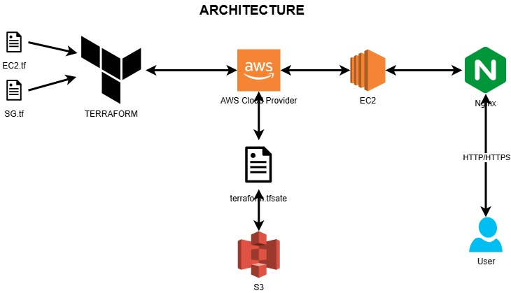

# Servidor web en AWS con Terraform

Despliega un servidor web con Nginx en una instancia EC2 usando un módulo propio de Terraform. El mismo módulo se invoca dos veces desde `main.tf` para crear dos entornos independientes, `dev` y `qa`, cada uno con su instancia, su security group y su par de llaves SSH.

## Objetivo

- Automatizar la creación de instancias EC2 configuradas como servidores web.
- Reutilizar un solo módulo para varios entornos y cambiar solo sus parámetros.
- Guardar el estado de Terraform en un backend remoto en S3.
- Dejar el proceso documentado para que se pueda repetir de principio a fin.

## Arquitectura



Cada entorno crea los mismos recursos:

| Recurso | Archivo | Función |
|---------|---------|---------|
| `aws_instance` | `ec2.tf` | Instancia que instala y arranca Nginx con un script de `user_data`. |
| `aws_security_group` y reglas | `sg.tf` | SSH (22) solo desde `ssh_allowed_cidrs`, HTTP (80) público y salida limitada a HTTP y HTTPS. |
| `aws_key_pair` | `key.tf` | Registra la llave pública para entrar por SSH. |
| Salidas | `outputs.tf` | Exponen la IP y el DNS públicos de la instancia. |

## Estructura

```text
.
├── main.tf                    # backend S3 y los módulos dev y qa
└── web_server_module/
    ├── ec2.tf                 # instancia EC2 con Nginx
    ├── key.tf                 # par de llaves SSH
    ├── outputs.tf             # IP y DNS públicos
    ├── provider.tf            # proveedor AWS y región
    ├── sg.tf                  # security group
    └── variables.tf           # parámetros del módulo
```

### Módulo `web_server_module`

| Variable | Descripción | Valor por defecto |
|----------|-------------|-------------------|
| `ami_id` | AMI de la instancia. Debe traer `yum` para que el script instale Nginx (por ejemplo Amazon Linux). | `ami-0453ec754f44f9a4a` |
| `instance_type` | Tipo de instancia. | `t3.micro` |
| `server_name` | Nombre del servidor; también prefija el security group y el par de llaves. | `web-server` |
| `environment` | Etiqueta del entorno. | `Dev` |

Salidas: `server_public_ip` y `server_public_dns`.

### Raíz (`main.tf`)

- Configura el backend S3 para el estado remoto.
- Invoca el módulo para `dev` (`web-server-dev`) y para `qa` (`web-server-qa`), ambos con `t3.medium`.
- Publica las salidas `server_dev_ip`, `server_dev_dns`, `server_qa_ip` y `server_qa_dns`.

### Por qué un módulo

- **Reutilización:** agregar un entorno nuevo es una invocación más del módulo con otros parámetros.
- **Mantenimiento:** cada tipo de recurso vive en su archivo, así que un cambio o una depuración tocan un solo lugar.
- **Consistencia:** dev y qa no pueden divergir por accidente porque comparten el mismo código.

## Requisitos

- Terraform 1.10 o superior ([guía de instalación](https://developer.hashicorp.com/terraform/tutorials/aws-get-started/install-cli)).
- AWS CLI con credenciales configuradas (`aws configure`) de un usuario o rol con permisos sobre EC2, pares de llaves, security groups y el bucket del estado ([documentación](https://docs.aws.amazon.com/cli/)).
- Un par de llaves SSH generado en local.
- Un bucket de S3 para el estado remoto.

## Preparación

### 1. Generar el par de llaves

El módulo lee la llave pública con `file("web-server-key.pub")`, una ruta relativa al directorio desde el que se ejecuta Terraform. Genera la llave dentro de `AWS/01-web-server`:

```bash
cd AWS/01-web-server
ssh-keygen -t rsa -b 4096 -f web-server-key
```

Los dos entornos usan esta misma llave. Los archivos de llaves no se versionan: el `.gitignore` del repositorio ya los excluye, y la llave privada nunca debe subirse.

### 2. Crear el bucket del estado

Si no tienes un bucket, créalo y activa el versionado para poder recuperar versiones anteriores del estado:

```bash
aws s3api create-bucket --bucket <nombre-del-bucket> --region us-east-1
aws s3api put-bucket-versioning \
  --bucket <nombre-del-bucket> \
  --versioning-configuration Status=Enabled
```

Luego edita el bloque `backend` de `main.tf` con tu bucket, la ruta del estado y la región:

```hcl
terraform {
  backend "s3" {
    bucket = "<nombre-del-bucket>"
    key    = "<ruta>/terraform.tfstate"
    region = "us-east-1"
  }
}
```

### 3. Ajustar los parámetros (opcional)

Cambia en `main.tf` la AMI, el tipo de instancia, el nombre o el entorno de cada módulo. Los valores por defecto de `web_server_module/variables.tf` aplican a lo que no se indique. La región está fijada en `web_server_module/provider.tf` (`us-east-1`).

## Despliegue

Desde `AWS/01-web-server`:

```bash
terraform init      # descarga el proveedor y configura el backend
terraform plan      # revisa los recursos que se crearán
terraform apply     # crea la infraestructura
```

## Probar el servidor

Consulta las salidas:

```bash
terraform output
```

Prueba HTTP en cada entorno con la IP que aparece en `server_dev_ip` o `server_qa_ip`:

```bash
curl http://<ip-publica>
```

Si el servidor está bien, la respuesta es la página de bienvenida de Nginx. El script de `user_data` tarda uno o dos minutos en terminar después de que la instancia pasa a `running`, así que si la primera petición falla, espera y repite.

Para entrar por SSH:

```bash
ssh -i web-server-key ec2-user@<ip-publica>
```

El usuario `ec2-user` aplica a Amazon Linux; en otra AMI será distinto.

## Costos aproximados

Dos instancias `t3.medium` encendidas todo el mes cuestan del orden de varias decenas de dólares en `us-east-1`, más el tráfico de salida y la IP pública. Si es solo una prueba, destruye los recursos al terminar.

## Consideraciones de seguridad

El security group limita SSH a `ssh_allowed_cidrs` (por defecto una red privada de ejemplo: cámbiala por tu IP) y deja HTTP (80) público a propósito, con la omisión `CKV_AWS_260` documentada en `sg.tf`. La salida se limita a los puertos 80 y 443. Queda pendiente asignar un rol IAM a la instancia (CKV2_AWS_41) y quitar el correo personal de las etiquetas.

## Limpieza

```bash
terraform destroy
```

Confirma con `yes`. El bucket del estado no lo gestiona este proyecto, así que no se borra; elimínalo aparte si ya no lo necesitas.

## Contacto

- GitHub: [JesquivelR](https://github.com/JesquivelR)
- LinkedIn: [esquivelrodriguez123](https://linkedin.com/in/esquivelrodriguez123)
